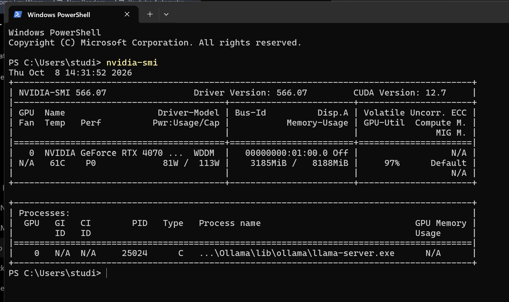
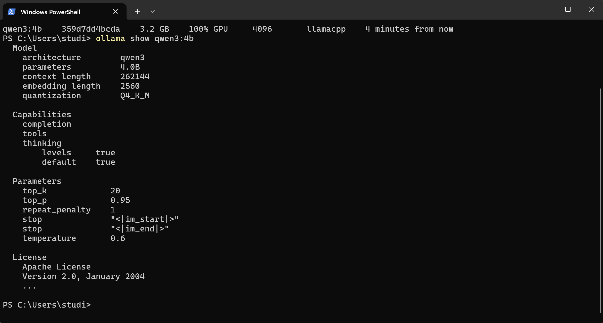
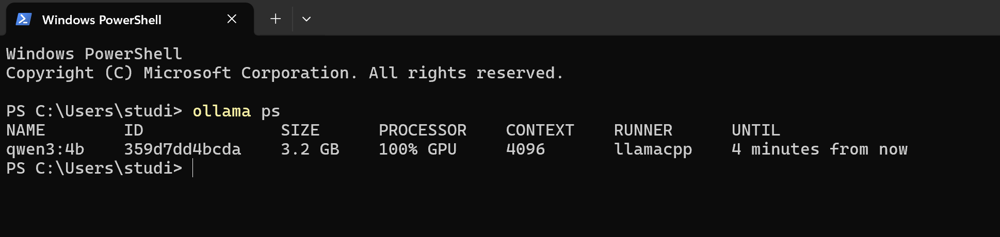
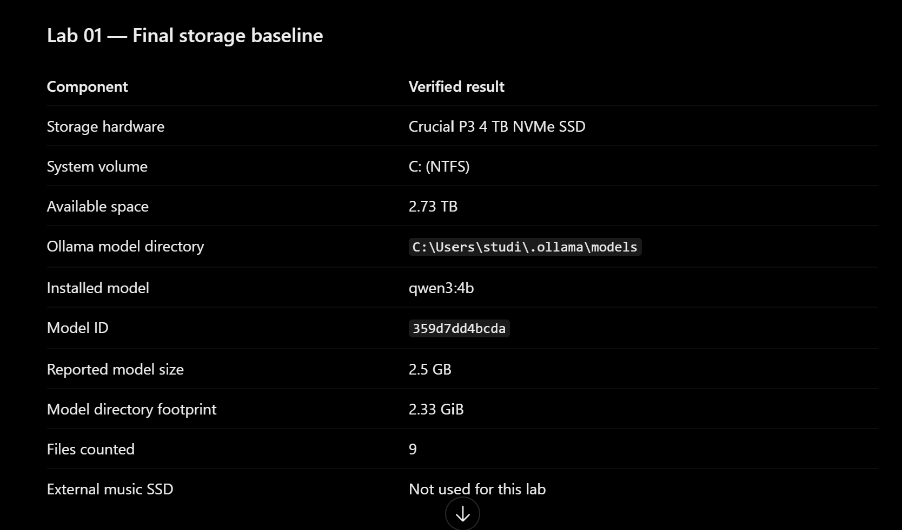
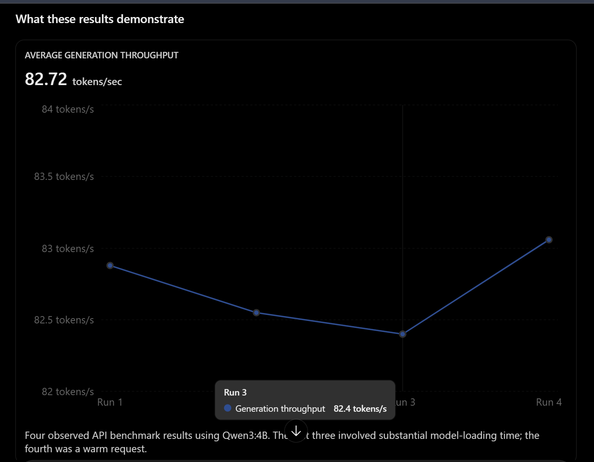
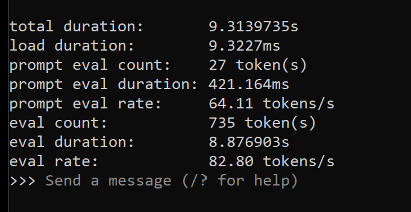
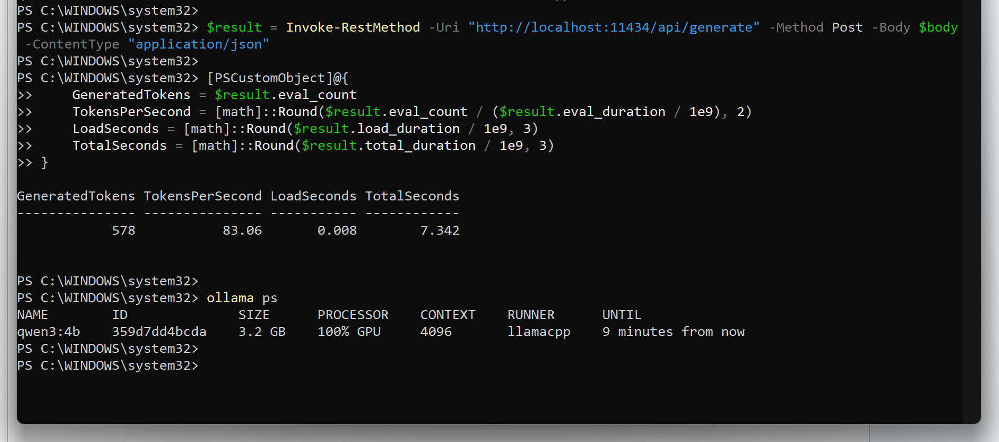
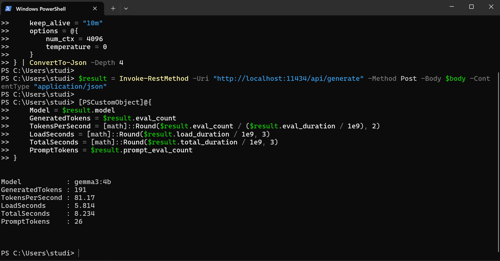
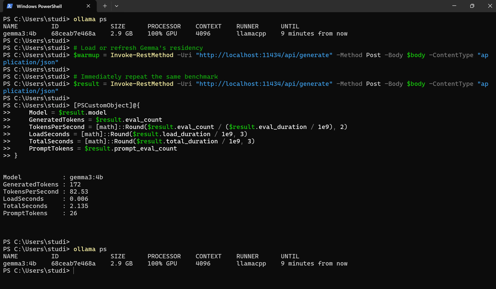

# Lab 01 — Ollama Deployment and GPU Verification

Status: Complete

## 1. Objective

Deploy a locally hosted large language model using Ollama on a Windows computer and verify that inference workloads are being processed by the GPU.

The purpose of this lab is to gain hands-on experience with local AI infrastructure, model deployment, GPU acceleration, and basic performance evaluation.

## 2. Lab Environment

The following hardware was used to deploy and test the Qwen3:4B model.

| Component | Specification |
|---|---|
| CPU | Intel Core i9-13980HX |
| GPU | NVIDIA GeForce RTX 4070 Laptop GPU |
| GPU VRAM | 8 GB |
| System RAM | 64 GB |
| Operating System | Windows 11 Home (64-bit), build 26200 |
| NVIDIA Driver | 566.07 |
| CUDA Version Reported by Driver | 12.7 |
| LLM Runtime | Ollama |
| Ollama Version | 0.40.11 |
| Model | Qwen3:4B |
| Quantization | Q4_K_M |
| Storage | Crucial P3 4 TB NVMe SSD (C:)|

### GPU Monitoring Results

The NVIDIA System Management Interface (`nvidia-smi`) was used to inspect GPU activity during local LLM operation.




**Observed results — October 8, 2026**

| Metric | Observed Value |
|---|---|
| GPU utilization | 97% |
| GPU memory usage | 3,185 / 8,188 MiB |
| GPU temperature | 61°C |
| GPU power consumption | 81 W |
| Reported power limit | 113 W |
| GPU compute process | llama-server.exe |

### Analysis

Ollama previously reported 100% GPU allocation for the Qwen3:4B model.

A separate NVIDIA monitoring snapshot reported 97% GPU utilization, demonstrating substantial GPU activity during the observation.

These results represent initial monitoring observations rather than a controlled performance benchmark.

Future testing will measure inference throughput, latency, and GPU resource consumption under repeatable workloads.

## 3. Pre-Deployment Preparation

Before deploying the local LLM environment, a full system image was created using AOMEI Backupper.

A bootable recovery USB drive was also prepared and tested to confirm that the recovery environment could launch.

This provided a recovery option in the event of configuration errors or system instability.

Note: Booting successfully into recovery media does not by itself verify that a complete system restore will succeed.

## 4. Ollama Deployment

Ollama was installed and configured to run a language model locally.

The initial deployment involved:

1. Preparing the Windows environment.
2. Installing Ollama.
3. Downloading the selected language model.
4. Running an interactive inference session.
5. Testing model responses.


### Installation and Deployment Commands

The following PowerShell commands were used or verified during Lab 01.

#### Verify Ollama Installation

```powershell
ollama --version
```

Displays the installed Ollama version.

Verified version during benchmarking: `0.40.11`.

#### Download a Language Model

```powershell
ollama pull qwen3:4b
```

Downloads the Qwen3:4B model from the Ollama model registry.

The model is stored locally and can be used without an internet connection after downloading.

#### Launch an Interactive Inference Session

```powershell
ollama run qwen3:4b
```

Loads the model and opens an interactive session.

To exit the session:

```text
/bye
```

#### List Installed Models

```powershell
ollama list
```

Displays locally installed models, their identifiers, and reported sizes.

#### Inspect Model Configuration

```powershell
ollama show qwen3:4b
```

Displays model information including architecture, parameter count, quantization, and context length.

#### Verify GPU Allocation

```powershell
ollama ps
```

Displays currently loaded models, processor allocation, context settings, and model retention information.

#### Unload a Model

```powershell
ollama stop qwen3:4b
```

Unloads the model from memory without deleting its downloaded files.

#### Display the Model Template

```powershell
ollama show --modelfile qwen3:4b
```

Displays the model's configuration template, including parameters and prompt formatting.

This command was used during troubleshooting of Qwen3 reasoning-mode behavior.


## 5. GPU Verification

The following command was used to inspect active model allocation:

```powershell
ollama ps
```

During testing, Ollama reported 100% GPU allocation for the running model.

This indicates that Ollama reported the model as fully GPU-resident during the observation.

It does not necessarily mean the GPU was operating at 100% computational utilization.

## 6. Initial Test Results

| Test | Observation |
|---|---|
| Local model execution | Successful |
| Text generation | Responsive |
| GPU model allocation | 100% reported |
| GPU utilization | 97% observed snapshot |
| GPU memory usage | 3,185 MiB observed |
| Tokens per second | Qwen3:4B averaged 82.72 tokens/s across four API runs |
| CPU utilization | Not yet documented |

## 7. Lessons Learned

* Local LLMs can execute on personally managed hardware without requiring a hosted inference service.
* Ollama provides command-line tools for managing and inspecting local models.
* GPU allocation and GPU utilization are different measurements.
* Performance observations should be supported by repeatable benchmarks.
* System backups and recovery planning are valuable preparation steps before infrastructure changes.

## 8. Model Configuration and Verification

The deployed model was inspected using the following PowerShell commands:

```powershell
ollama list
ollama ps
ollama show qwen3:4b
```

### Verified Configuration

| Property | Value |
|---|---|
| Model | qwen3:4b |
| Model ID | 359d7dd4bcda |
| Architecture | qwen3 |
| Parameters | 4.0 billion |
| Quantization | Q4_K_M |
| Downloaded model size | 2.5 GB |
| Loaded model size | 3.2 GB |
| GPU allocation | 100% |
| Model maximum context | 262,144 tokens |
| Active inference context | 4,096 tokens |
| Embedding length | 2,560 |
| Inference backend | llama.cpp |

### Model Configuration Screenshot



### Observations

The Qwen3:4B model was successfully deployed through Ollama on Windows.

The `ollama ps` command reported 100% GPU allocation, confirming that Ollama placed the loaded model entirely on the GPU at the time of observation.

The model uses Q4_K_M quantization, reducing its memory footprint compared with higher-precision representations.

Although the model supports a maximum context length of 262,144 tokens, the active Ollama session was configured with 4,096 tokens.




## 9. Storage Specification

The 2.5 GB reported by Ollama and 2.33 GiB measured by PowerShell are consistent after accounting for decimal versus binary units.

One technical detail worth remembering: ollama list confirms that Qwen3:4B is the only model currently registered. The directory measurement includes its associated files, so we should describe 2.33 GiB as the total Ollama model-directory footprint, rather than attributing every byte exclusively to model weights.

The storage measurements above were recorded before Gemma 3 4B was installed. They represent the original Qwen3-only storage baseline.




### Verification Status

- [x] Model installed
- [x] Model configuration inspected
- [x] Quantization identified
- [x] GPU allocation verified
- [x] GPU utilization measured (single snapshot)
- [x] GPU memory usage recorded
- [x] Inference throughput benchmarked
- [x] Performance compared across models


## 10. Inference Performance Benchmarking

### Objective


Measure and evaluate the inference performance of the locally deployed Qwen3:4B model using Ollama's API.

The purpose of this benchmark is to establish a repeatable performance baseline by measuring token generation throughput, prompt processing, total response duration, and model loading time.

The experiment also compares cold-load and warm-inference behavior to determine how model residency in GPU memory affects overall response time.


### Test Configuration


| Parameter | Configuration |
|---|---|
| CPU | Intel Core i9-13980HX |
| GPU | NVIDIA RTX 4070 Laptop GPU (8 GB VRAM) |
| System RAM | 64 GB |
| Operating System | Windows 11 Home |
| Ollama Version | 0.40.11 |
| Model | Qwen3:4B |
| Quantization | Q4_K_M |
| API Endpoint | http://localhost:11434/api/generate |
| Context Window | 4,096 tokens |
| Temperature | 0 |
| Streaming | Disabled |
| Model Retention | 10 minutes |


### Benchmark Methodology


The Qwen3:4B model was benchmarked using Ollama's local REST API through Windows PowerShell.

Testing was conducted using the `/api/generate` endpoint with a consistent prompt and model configuration.

The benchmark prompt was:

> Explain the difference between CPU and GPU processing in approximately 150 words.

Each API request was configured with:

- Streaming disabled (`stream = false`).
- Temperature set to zero (`temperature = 0`).
- Context window set to 4,096 tokens (`num_ctx = 4096`).
- Model retention set to 10 minutes (`keep_alive = "10m"`).

Four controlled API inference requests were recorded.

The first three requests included approximately five seconds of model-loading time. The fourth request was executed while the model was already loaded in GPU memory, producing a substantially shorter load duration.

Ollama's API returned timing measurements in nanoseconds. These were converted into seconds to calculate inference throughput and compare cold-load and warm-inference behavior.

Generation throughput was calculated using:

Tokens per second = Generated tokens / Generation duration (seconds)

The benchmark also recorded total request duration, model loading duration, and generated token counts.

GPU residency was verified using the `ollama ps` command.


### Benchmark Results


Four controlled API benchmark runs were completed using Qwen3:4B with consistent model settings and the same input prompt.

| Metric | Run 1 | Run 2 | Run 3 | Run 4 (Warm) |
|---|---:|---:|---:|---:|
| Generated tokens | 642 | 642 | 642 | 578 |
| Generation throughput (tokens/s) | 82.88 | 82.55 | 82.40 | 83.06 |
| Model load duration (s) | 5.305 | 4.983 | 4.976 | 0.008 |
| Total request duration (s) | 13.096 | 12.802 | 12.807 | 7.342 |



### Performance Summary

| Measurement | Result |
|---|---:|
| Average generation throughput | 82.72 tokens/s |
| Minimum generation throughput | 82.40 tokens/s |
| Maximum generation throughput | 83.06 tokens/s |
| Generation throughput range | 0.66 tokens/s |
| Warm-inference model load duration | 0.008 seconds |
| Cold-load duration range | 4.976–5.305 seconds |

The average generation throughput was calculated across all four API benchmark runs.

The results indicate stable token generation throughput under the tested conditions, despite differences in model-loading duration.


### Analysis and Observations


The Qwen3:4B model demonstrated consistent inference throughput across four controlled API benchmark runs on the NVIDIA RTX 4070 Laptop GPU.

Generation throughput ranged from 82.40 to 83.06 tokens per second, with an average of 82.72 tokens per second.

### GPU Performance

Previous GPU verification confirmed that Ollama reported 100% GPU allocation for the model.

The benchmark results demonstrate that the system can maintain consistent token generation throughput under the tested configuration.

### Cold-Load vs. Warm-Inference Performance

The first three API benchmark runs reported model-loading durations between 4.976 and 5.305 seconds.

During the fourth run, the model was verified as already loaded in GPU memory using `ollama ps`.

The fourth run reported a model-loading duration of approximately 0.008 seconds.

These observations demonstrate that retaining a model in memory can substantially reduce model-loading overhead.

### Performance Consistency

Generation throughput varied by only 0.66 tokens per second across the four runs.

Although the total response duration differed between tests, generation throughput remained relatively stable.

Total response duration was influenced by model-loading overhead and differences in the number of generated tokens.

### Limitations

These measurements represent a preliminary performance baseline using a single model, one prompt, and a limited number of trials.

The benchmark did not independently measure time to first token or conduct a sustained GPU stress test.

A preliminary comparison with Gemma 3 4B was completed. Because model tokenization and reasoning behavior differ, the results should not be interpreted as a definitive comparison of equivalent workloads or overall model quality.


### Qwen3 Reasoning-Mode Observation

During additional testing, Qwen3:4B continued generating reasoning-style text despite API requests specifying `think = false`.

The generated output included a closing `</think>` tag, and multiple requests reached their configured output-token limits.

Inspection of the model's Modelfile revealed a prompt template that explicitly inserts an opening `<think>` tag at the beginning of assistant generation without checking the thinking-mode setting in that branch.

This behavior may explain why reasoning-style output persisted. Further testing would be needed to establish the exact interaction between the model template and Ollama 0.40.11.

The original benchmark measurements remain recorded as observed inference performance. They should not be interpreted as a controlled comparison of non-reasoning output.


### Cross-Model Performance Comparison

Two locally deployed language models were evaluated using Ollama 0.40.11 on the NVIDIA RTX 4070 Laptop GPU.

Both models were tested through Ollama's local REST API using the same CPU-versus-GPU explanation prompt, a 4,096-token context window, temperature zero, and streaming disabled.

#### Model Configuration

| Specification | Qwen3:4B | Gemma 3 4B |
|---|---|---|
| Architecture | qwen3 | gemma3 |
| Parameters | 4.0B | 3.9B |
| Quantization | Q4_K_M | Q4_K_M |
| Download Size | 2.5 GB | 3.4 GB |
| Loaded Model Size | 3.2 GB | 2.9 GB |
| GPU Allocation | 100% GPU | 100% GPU |

#### Performance Results

| Measurement | Qwen3:4B | Gemma 3 4B |
|---|---:|---:|
| API Trials | 4 | 3 |
| Average Generation Throughput | 82.72 tokens/s | 81.75 tokens/s |
| Warm-Inference Throughput | 83.06 tokens/s | 82.53 tokens/s |
| Warm Model Load Duration | 0.008 s | 0.006 s |
| Warm Total Request Duration | 7.342 s | 2.135 s |
| Warm Generated Tokens | 578 | 172 |

#### Observations

Both models demonstrated similar token generation throughput on the same GPU.

Qwen3:4B achieved an average generation throughput of 82.72 tokens per second, while Gemma 3 4B averaged 81.75 tokens per second.

Gemma 3 completed the warm-inference request in less time, but it generated substantially fewer tokens.

Because the models use different tokenizers and produce different amounts of output, total response duration cannot be used alone to determine which model is inherently faster.

Additional Qwen3 testing revealed that reasoning-style text continued to appear despite attempts to disable thinking mode.

Therefore, these measurements represent preliminary cross-model infrastructure observations rather than a definitive comparison of model efficiency, answer quality, or equivalent non-reasoning workloads.

Both models successfully executed inference with Ollama reporting 100% GPU allocation.


### Evidence











## 11. Next Steps

- Perform final documentation review and verification.
- Confirm all benchmark screenshots display correctly.
- Review and finalize Lab 01 results and conclusions.
- Begin Lab 02 after Lab 01 is formally completed.

